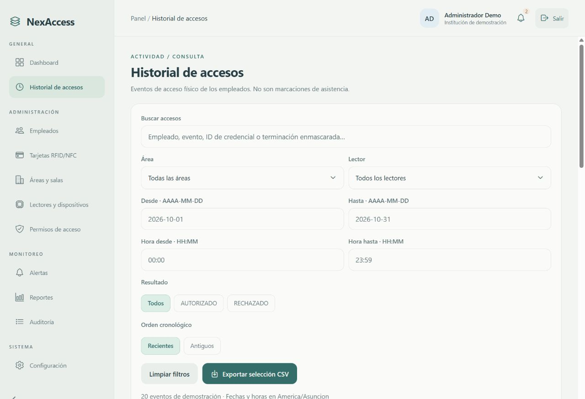

# NexAccess

Dos plantillas de frontend para el sistema NexAccess de control de accesos físicos y consulta de asistencia: un portal web administrativo y una aplicación móvil. Están construidas con React Native, TypeScript, Expo y Expo Router.

**Son prototipos independientes con datos ficticios.** No incluyen backend, autenticación real, PostgreSQL, integración ESP32, NFC real ni apertura de puertas. Las acciones son simulaciones locales.

## Elegir una plantilla

| Plantilla | Uso | Documentación |
|---|---|---|
| [`web/`](web/) | Portal administrativo con menú lateral, empleados, credenciales, áreas, lectores, permisos, alertas, reportes y auditoría | [Instalación](web/README.md), [revisión de requisitos](web/REVISION_REQUISITOS.md) |
| [`mobile/`](mobile/) | App para empleados, Seguridad, RRHH y Administración, con cinco pestañas, credencial visual, accesos, asistencia y notificaciones | [Instalación](mobile/README.md), [integración](mobile/INTEGRACION.md) |

Cada carpeta tiene su propio `package.json` y `package-lock.json`. Instalá sus dependencias por separado. La carpeta raíz no requiere `npm install`.

## Ejecutar el portal web

Requisitos: Git, Node.js con npm y un navegador. Se verificó con Node 24.19.0.

```powershell
git clone https://github.com/Trota2000/NexAccess.git
cd NexAccess/web
npm ci
npm run web
```

Abrí la dirección local que muestre Expo. Credenciales ficticias: usuario `admin`, contraseña `NexAccess2026!`. No hay registro público. El portal actual usa una única cuenta de demostración administrativa.



## Ejecutar la aplicación móvil

Desde otra terminal, en el repositorio clonado:

```powershell
cd mobile
npm ci
npx expo start --go
```

Si estás dentro de `web`, usá `cd ../mobile`. Escaneá el QR con Expo Go compatible con SDK 57 y usá la misma red que la computadora. Para probar en navegador: `npm run web`.

Seleccioná un perfil e ingresá su usuario; todos usan la contraseña ficticia `NexAccess2026!`:

| Perfil | Usuario |
|---|---|
| Empleado | `empleado` |
| Seguridad | `seguridad` |
| Recursos Humanos | `rrhh` |
| Administrador | `admin` |

La sesión no se guarda. El móvil conserva únicamente datos ficticios y preferencias en el dispositivo; se pueden restablecer desde Perfil.

## Verificación y límites

- **Web:** 32 pruebas aprobadas, TypeScript y ESLint sin errores, revisión en navegador de escritorio/teléfono y exportación CSV comprobada. [Detalle](web/VERIFICACION.md).
- **Móvil:** 16 pruebas aprobadas, TypeScript y ESLint, Expo Doctor 21/21, exportaciones para web/Android/iOS y revisión visual web a tamaño de teléfono. [Detalle](mobile/VERIFICACION.md).
- Se intentó Expo Go en Android, pero no había SDK, emulador ni dispositivo disponible. La ejecución nativa en hardware sigue pendiente; una exportación no sustituye esa prueba.
- La web cumple parcialmente el documento original. La separación de cuentas administrativas, ciertos contratos y el módulo de asistencia web siguen pendientes. No se afirma que los prototipos estén listos para producción.

Las guías conservan el contexto de las verificaciones realizadas antes de publicar este repositorio. Sus referencias a `outputs/nexaccess`, `outputs/nexaccess-mobile` o `work/` corresponden al entorno de desarrollo original; aquí las plantillas están en `web/` y `mobile/`.

## Colaborar

Consultá [CONTRIBUTING.md](CONTRIBUTING.md). El repositorio público permite consultar y clonar; los permisos de escritura se administran desde **Settings → Collaborators**. No se invita automáticamente a ninguna persona.

Las plantillas usan roles físicos y roles administrativos distintos. Leé la [comparación e integración](docs/COMPARACION.md) antes de compartir modelos o conectar endpoints.

Referencias del proyecto: [documentación NexAccess](https://github.com/juliobernal92/NexAccess_docs) y [backend NexAccess](https://github.com/sof2702/NexAccess). Este repositorio contiene únicamente estas dos plantillas de frontend.
