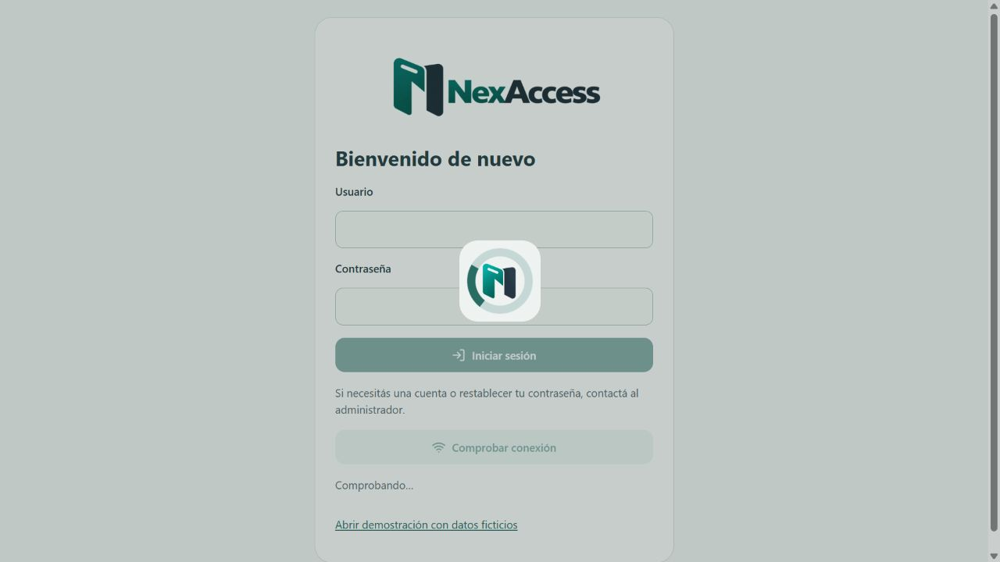
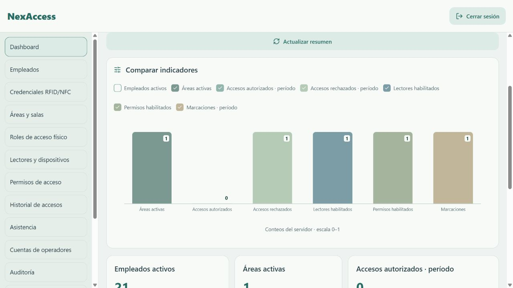
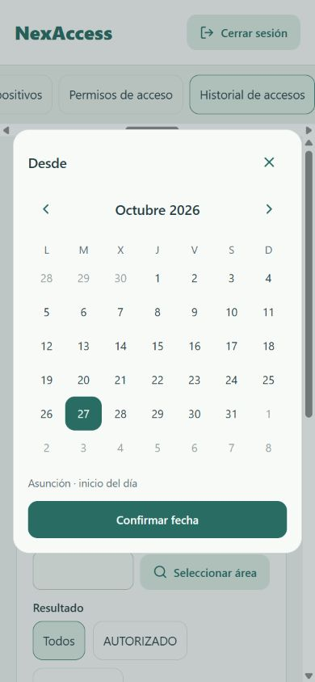
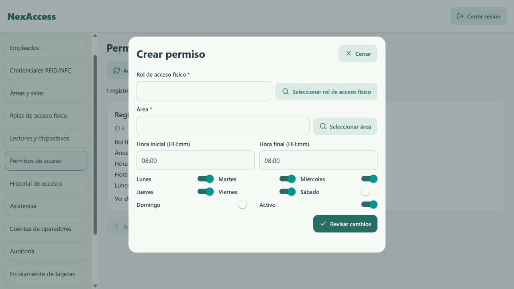
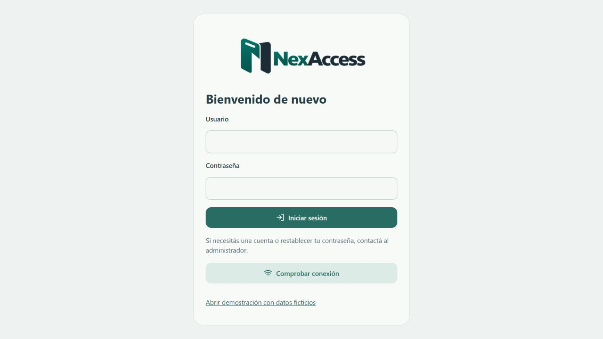
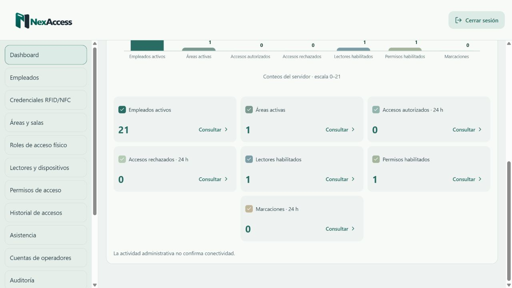
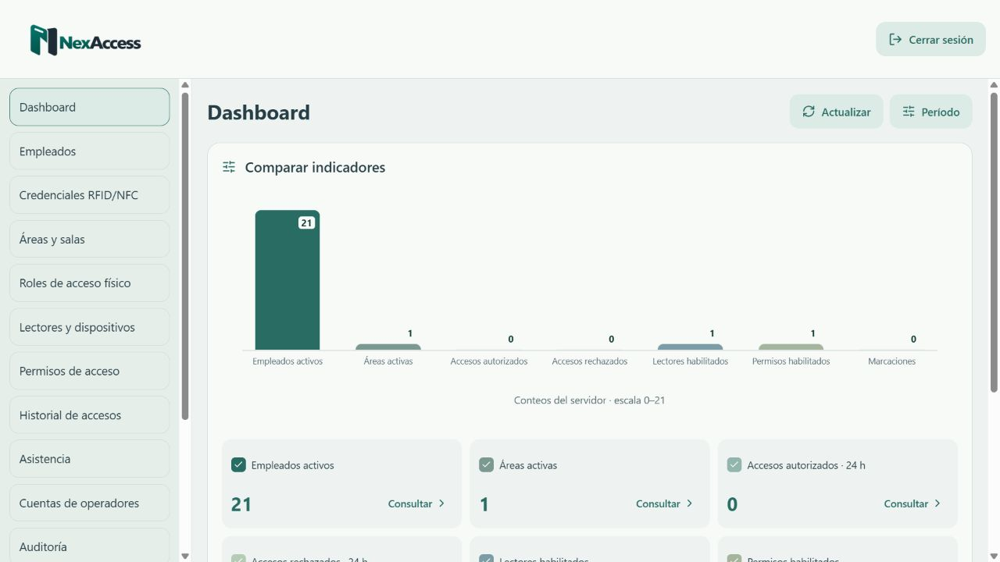
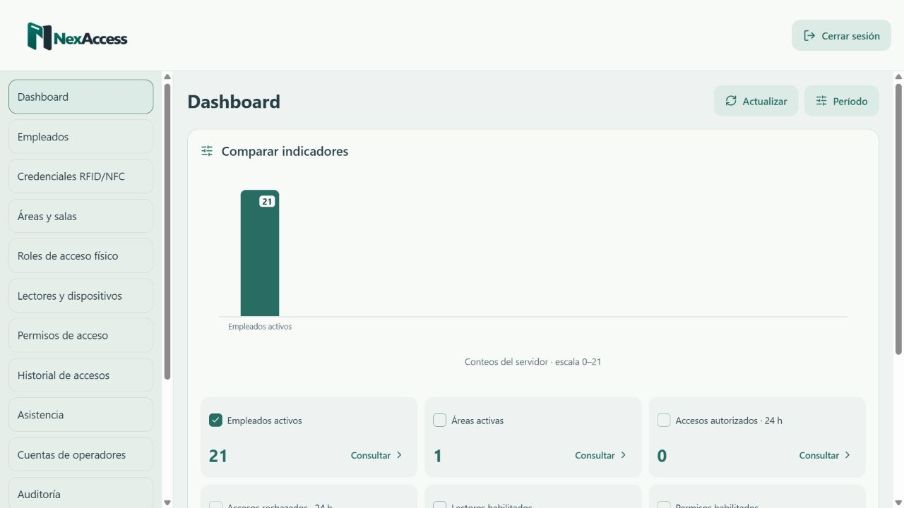

# Cambios visuales y exportación — 27/10/2026

Se mantienen Expo Router, la navegación, la paleta, el login y las operaciones existentes. El código conectado se mantiene en `integration/source/` y se sincroniza con web y mobile.

## Cambios

- Indicador centrado con marca estática y anillo giratorio verde; capa de fondo de opacidad 0,22. Se muestra durante navegación, filtros, apertura de formularios y operaciones. Se usa el símbolo original adjunto, estático dentro del anillo. Los PNG transparentes se conservan sin alteraciones y se sincronizan entre ambas apps.
- Iconos Lucide para React Native, compatibles con la web de Expo; texto e icono en acciones como crear, actualizar y filtros.
- Dashboard con gráfico de barras y valores superpuestos, casillas para elegir indicadores y período de consulta mediante calendario. Empleados/áreas/lectores/permisos siguen representando estado actual: esos endpoints no tienen filtro de fecha. Solo eventos y marcaciones reciben el período. Los indicadores fallidos no se muestran como cero.
- Selectores de referencias al lado del campo; días y horarios agrupados; acciones de formulario compactas. Se retiraron los subtítulos de formulario, encabezado de sesión y módulos, sin cambiar las validaciones.
- Calendario para campos de fecha y rangos, con selección de hora/minutos cuando corresponde. Desde incluye 00:00 y Hasta 23:59:59.999 de Asunción; el transporte usa ISO UTC explícito. Cancelar no aplica cambios y limpiar restaura el filtro sin fecha.

## Revisión del backend y exportaciones

Se consultó `sof2702/NexAccess/main` en `1e45035`. Los controladores y servicios de exportación no cambiaron respecto al contrato anterior:

- `GET /api/v1/access-events/export`: CSV UTF-8, filtros AccessEventQuery y bearer ADMIN/SEGURIDAD.
- `GET /api/v1/attendance/export`: CSV UTF-8, filtros AttendanceQuery y bearer ADMIN/RRHH.

No se encontró exportación nativa XLSX ni PDF. Se conserva CSV y se agrega PDF generado en el frontend **a partir del mismo CSV del servidor**, con los filtros aplicados; no se exporta únicamente la página visible. CSV puede abrirse en Excel, pero no se presenta como un archivo XLSX. Se conserva el control previo de 50.000 registros; no se truncan filas en el frontend.

En web, Exportar PDF prepara un documento de impresión y permite elegir **Guardar como PDF** en el diálogo del navegador. En Android/iOS se usa Expo Print y Expo Sharing. Es necesario reconstruir una app nativa instalada para incorporar estas nuevas dependencias; no se realizó ejecución física en esta revisión.

El HTML del reporte escapa contenido del servidor, conserva acentos, comillas y saltos de línea CSV, y presenta filtros y columnas con etiquetas legibles.

## Verificación

- Prueba autenticada real contra `https://nx.rattenkoenig.net/api/v1`: ambos endpoints devolvieron 200 y `text/csv` para el rango del calendario 26/10/2026, equivalente a `2026-10-26T03:00:00.000Z`–`2026-10-27T02:59:59.999Z`. Ambos resultados estaban vacíos; esto valida contrato, autenticación y aceptación del rango, no la selección de filas reales. No se guardaron credenciales, JWT ni datos personales en el repositorio. Exportar puede generar un registro de auditoría del backend.
- Prueba de navegador con fixture de loopback y fila sintética del 26/10: calendario Desde/Hasta, Aplicar filtros, CSV y preparación HTML de PDF. Se comprobó que la solicitud de exportación conserva exactamente el rango UTC y no incluye paginación ni tokens en la URL.
- Pruebas automatizadas de límites de día, meses bisiestos, rango invertido, hora inválida, CSV con BOM/comillas/saltos de línea, HTML escapado, período del dashboard y selección/cancelación del calendario.
- La preview de pruebas usa la exportación de Expo web en 8096 y un proxy al fixture 9060; no modifica el backend desplegado. El intento de iniciar otro servidor Expo Go fue rechazado por la revisión automática del entorno; la exportación web sí funcionó. Esto no acredita ejecución en Expo Go ni en un dispositivo físico.

El despliegue público no se actualiza hasta revisar y fusionar la rama de cambios visuales. El backend, PostgreSQL, Docker y el workflow de despliegue permanecen sin cambios.

Resultado local: 40 pruebas de integración, 31 pruebas de móvil/interfaz y 32 de maqueta web aprobadas (103 en total). TypeScript y ESLint sin errores en ambas apps. Expo exportó correctamente la web. Se excluyó `dist` del análisis de TypeScript para no revisar los bundles JavaScript generados, conservando las exclusiones de configuración y proyectos nativos.

En navegador se verificaron también la selección de indicadores, su cambio de escala, la actualización del período y el calendario en 390×844. El entorno de navegador mostró el documento HTML del PDF preparado con su fila sintética y el rango correcto; no se guardó un archivo PDF desde ese navegador de pruebas. El guardado final depende del diálogo de impresión del navegador normal.

Los logos definitivos están incorporados: versión completa en login y encabezado, símbolo en el cargador. El login usa el mismo fondo de carga durante autenticación y comprobación de conexión, botones Lucide y no ofrece registro. Se retiró su subtítulo introductorio, conservando la ayuda de acceso y los errores.

La revisión de los logos incluye autenticación y cierre de sesión con fixture, comprobación de conexión y capturas del login y del cargador. Dos pruebas adicionales verifican la recuperación del formulario tras credenciales rechazadas y una respuesta de salud válida.

## Resumen integrado del dashboard

Se retiraron las tarjetas grandes que repetían los datos del gráfico. El mismo panel del gráfico contiene ahora una cuadrícula compacta de indicadores, con columnas del mismo ancho (tres, dos o una según el espacio disponible). Cada indicador conserva su total, casilla para mostrar/ocultar la barra y acceso Consultar con los filtros originales. Los errores y la aclaración de lectores se conservan; las casillas no ocultan los accesos de consulta. No cambia la API ni la selección de período.

## Cabecera compacta del dashboard

El período queda plegado por defecto detrás del botón Período. Al desplegarlo se mantienen los calendarios Desde/Hasta, validación y aplicación explícita. Un rango válido cierra el panel y deja una indicación breve de las fechas aplicadas. Actualizar conserva ese rango y usa un botón compacto junto al título, con las mismas dimensiones y paleta que las acciones de Empleados. Los demás módulos no cambian de tamaño.

## Ancho y posición estables de las barras

Cada indicador conserva su posición horizontal aunque se desmarquen otros. Se reserva su columna vacía y el ancho de las barras queda limitado a 56 px. El ancho del gráfico se calcula con todos los indicadores, por lo que tampoco cambia el desplazamiento horizontal en móvil. Se conserva el ajuste de escala vertical según los datos seleccionados, la paleta, las casillas, los valores no disponibles, el estado sin selección y las consultas.

