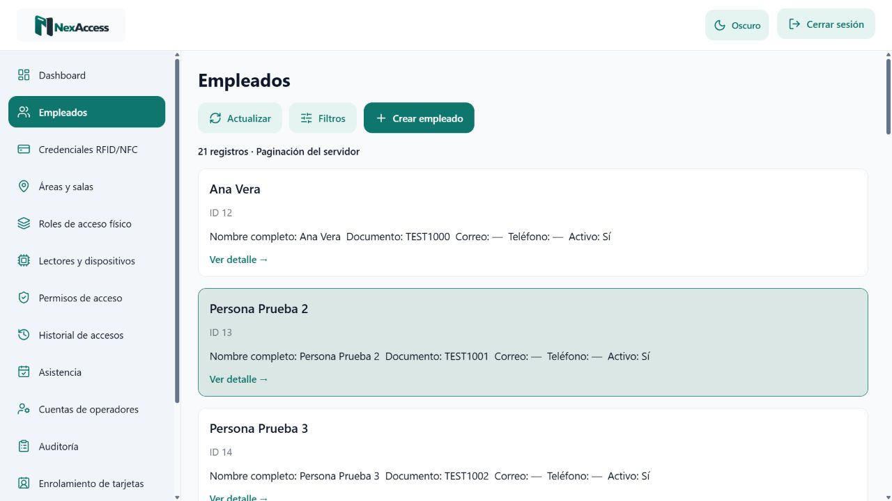
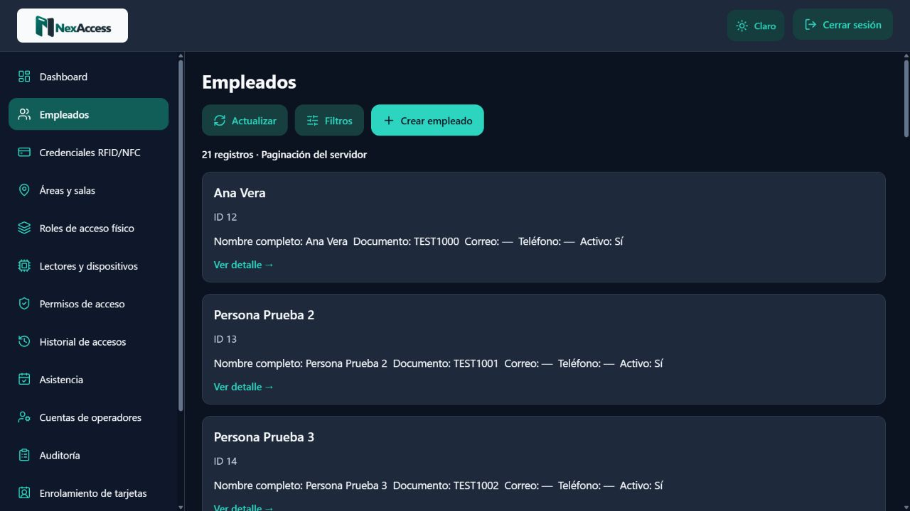
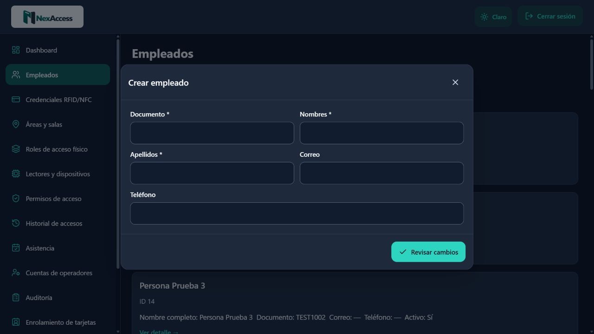
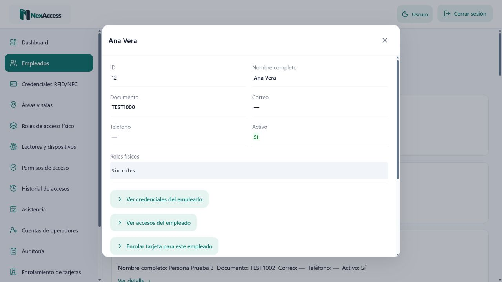
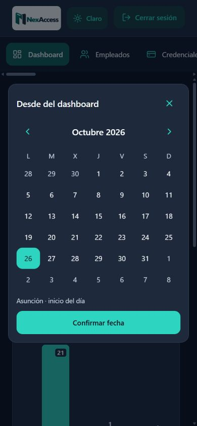

# Rediseño UI/UX de NexAccess

## Alcance y decisiones

Se mantiene Expo Router, React Native Web y la arquitectura de fuentes compartidas `integration/source/`, sincronizadas a `web/src/api/` y `mobile/src/api/`. La aplicación conectada se renderiza desde `ApiApp.tsx`. No se rehízo el proyecto ni se añadieron paquetes.

El menú conectado cambia de módulo con estado interno y todos esos módulos comparten `/login`; el token y la sesión continúan en memoria. Se conserva ese comportamiento. **Persistir el módulo al recargar o asignarle una ruta nueva requiere una modificación funcional y queda pendiente de autorización.** La selección visual refleja el módulo real del Workspace y no se modifica al cambiar el tema. La maqueta web que ya tiene rutas conserva su resaltado basado en `usePathname`, incluidos los detalles anidados.

## Sistema de diseño

- `integration/source/design-tokens.json`: fuente única de colores claros/oscuros y estados semánticos. Los colores de primer plano semánticos se adaptan para contraste AA; los acentos conservan los colores oficiales.
- `Theme.tsx`: preferencia visual compartida mediante un store React sencillo, colores reactivos y espaciado 4/8/12/16/24/32. No guarda credenciales, JWT, filtros ni datos del negocio.
- `nexaccess.theme` en localStorage: preferencia explícita de la web; sin valor válido se respeta el sistema. Si el almacenamiento no está disponible, el cambio visual sigue funcionando durante la sesión.
- `integration/theme-init.js` y `theme-base.css`, más `integration/sync.cjs`: generan las variables CSS y la plantilla HTML de Expo. La preferencia se aplica antes del montaje; el CSS se versiona en el enlace. Los componentes de la maqueta web usan las mismas variables.
- En las pantallas compartidas nativas se reutiliza la paleta y la preferencia del sistema; no se añadió almacenamiento nativo. La persistencia comprobada es la de la web. No se ejecutó un APK ni un dispositivo físico.

## Componentes mejorados

- Header y login con Moon/Sun, tooltip y nombre accesible; marca original legible en ambos temas.
- Sidebar con Lucide de 19 px, selección de fondo verde petróleo, texto e icono claros, hover discreto y foco visible. Se conserva la distribución móvil actual.
- Botones principales/secundarios y acciones destructivas con jerarquía consistente; estados deshabilitados y callbacks intactos.
- Listas con bordes suaves, densidad consistente y hover, sin cambiar orden, columnas, búsqueda o paginación.
- Gráfico y leyendas adaptados a cada tema. Se mantienen las barras con posición y ancho estables y las tarjetas compactas.
- Formularios con dos columnas para campos breves, filas completas para textos extensos y una columna en espacios estrechos. Las reglas, campos y controles siguen siendo los originales.

## Modales existentes

La hoja compartida `Sheet` cubre formularios, detalles, referencias, confirmaciones y claves de dispositivos de los módulos existentes. Se unificaron encabezado, cierre X accesible, bordes de 16 px, divisores, contenido interno desplazable y máximo del 85 % de la ventana. La acción Revisar cambios y las acciones finales de confirmación quedan en el pie; mantienen los mismos handlers. Los detalles breves se agrupan en columnas y los objetos técnicos usan monoespaciado con ajuste de línea.

El calendario conserva sus valores, horas, zona y botones originales, con cabecera/confirmación estables y contenido acotado. El cargador recibe el tema y respeta movimiento reducido. Las capas portadas reciben los colores directamente del mismo store, sin depender de un contenedor DOM local.

Los estados se colorean solo a partir de valores explícitos como AUTORIZADO/RECHAZADO, isActive o estado del enrolamiento. **LOGIN no se interpreta como éxito.** El texto del estado permanece visible.

Se conserva el foco y Escape proporcionados por Modal de React Native Web. Se agregaron atributos ARIA explícitos a controles seleccionables porque esta versión web no traslada `accessibilityState` a todas las propiedades ARIA.

## Verificaciones ejecutadas

- 45 pruebas de integración, incluidos contratos API, límites de fecha, autenticación, exportaciones y cinco pruebas de contraste/preferencia inicial.
- 42 pruebas de interfaz/móvil; los diez flujos de pantallas conectadas se ejecutan tanto en claro como en oscuro. La prueba de tema también confirma que el calendario conserva la fecha.
- 32 pruebas de la maqueta web.
- Comparación de las nueve funciones navigate, prepare, successSecret, createOrEdit, actionForm, commit, openDetails, exportCsv y login: código funcional sin cambios.
- Comprobación de contenido sin cambios de client.ts, resources.ts, workflows.ts, contract.ts y dependencias.

Los reportes PDF mantienen su presentación apta para impresión, independiente del tema de pantalla. No se cambió el backend, el proxy, Docker, la base de datos ni el workflow de despliegue.

## Revisión manual pendiente

- Lectores de pantalla reales y matriz completa de navegadores/dispositivos.
- Aplicación nativa instalada y persistencia de preferencia en el dispositivo, si se solicita ese alcance.
- Autorización separada para persistir el módulo al recargar, según la restricción de no cambiar comportamiento.

No se afirma certificación WCAG completa: las pruebas automatizadas validan las combinaciones de tokens de texto/estado y los bordes/foco de controles. Se necesita una auditoría manual de tecnologías de asistencia para certificar la aplicación.

## Resultado de compilación y revisión en navegador

TypeScript y ESLint de ambas aplicaciones finalizaron sin errores ni advertencias. La exportación web de producción terminó correctamente. En la última ejecución, las 42 pruebas de interfaz finalizaron sin la advertencia inicial del temporizador: el helper de login espera ahora a que desaparezca el overlay real antes de continuar. Total local: 119 pruebas aprobadas (45 + 42 + 32).

En el navegador se comprobaron claro/oscuro, persistencia tras recargar, sidebar activo con aria-current, los 15 módulos existentes, modales de creación y detalles, teclado Tab/Escape y retorno del foco, calendario oscuro y formularios en 390 px. El modal móvil midió 616 px dentro del máximo de 717,4 px; no hubo desbordamiento horizontal. No se observaron errores ni advertencias en la consola del navegador. Todas las pruebas de navegador usaron un fixture local; no se crearon registros en producción.

La disposición y algunos mensajes extensos siguen dependiendo del contenido real del servidor. Las acciones condicionales de detalles permanecen disponibles dentro del contenido; las acciones finales directas y Revisar cambios se presentan en el pie fijo.

## Archivos nuevos y modificados

Las copias en web/src/api y mobile/src/api se generan desde integration/source mediante node integration/sync.cjs.

- `docs/screenshots/design-calendario-movil.jpg`
- `docs/screenshots/design-calendario-oscuro.jpg`
- `docs/screenshots/design-dashboard-oscuro.jpg`
- `docs/screenshots/design-detalle-claro.jpg`
- `docs/screenshots/design-lista-claro.jpg`
- `docs/screenshots/design-lista-oscuro.jpg`
- `docs/screenshots/design-login-claro.jpg`
- `docs/screenshots/design-modal-oscuro.jpg`
- `integration/source/ApiApp.tsx`
- `integration/source/BusyOverlay.tsx`
- `integration/source/CalendarField.tsx`
- `integration/source/MetricChart.tsx`
- `integration/source/Overview.tsx`
- `integration/source/Theme.tsx`
- `integration/source/design-tokens.json`
- `integration/sync.cjs`
- `integration/tests/design-system.test.cjs`
- `integration/theme-base.css`
- `integration/theme-init.js`
- `mobile/public/index.html`
- `mobile/public/nexaccess-theme.css`
- `mobile/src/api/ApiApp.tsx`
- `mobile/src/api/BusyOverlay.tsx`
- `mobile/src/api/CalendarField.tsx`
- `mobile/src/api/MetricChart.tsx`
- `mobile/src/api/Overview.tsx`
- `mobile/src/api/Theme.tsx`
- `mobile/src/api/design-tokens.json`
- `mobile/tests/api-screens.test.tsx`
- `mobile/tests/icons.tsx`
- `mobile/tests/theme.test.tsx`
- `web/public/index.html`
- `web/public/nexaccess-theme.css`
- `web/src/api/ApiApp.tsx`
- `web/src/api/BusyOverlay.tsx`
- `web/src/api/CalendarField.tsx`
- `web/src/api/MetricChart.tsx`
- `web/src/api/Overview.tsx`
- `web/src/api/Theme.tsx`
- `web/src/api/design-tokens.json`
- `web/src/components/BarChart.tsx`
- `web/src/components/Screen.tsx`
- `web/src/components/SelectField.tsx`
- `web/src/components/ui.tsx`
- `web/src/features/access/EventList.tsx`
- `web/src/features/auth/Login.tsx`
- `web/src/features/settings/Settings.tsx`
- `web/src/features/users/UserForm.tsx`
- `web/src/theme.ts`
