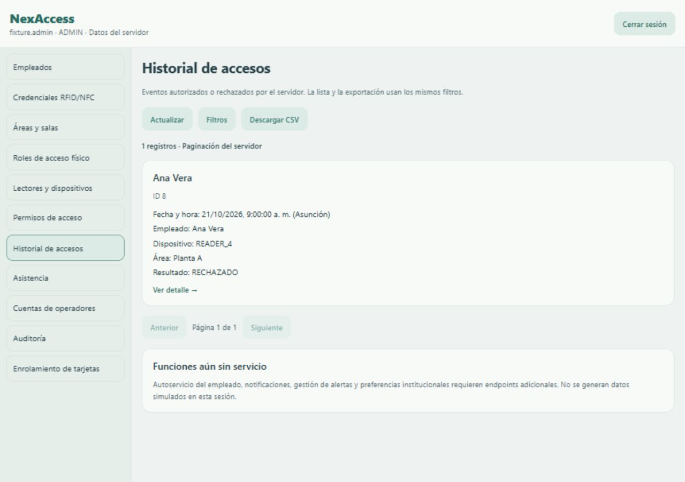
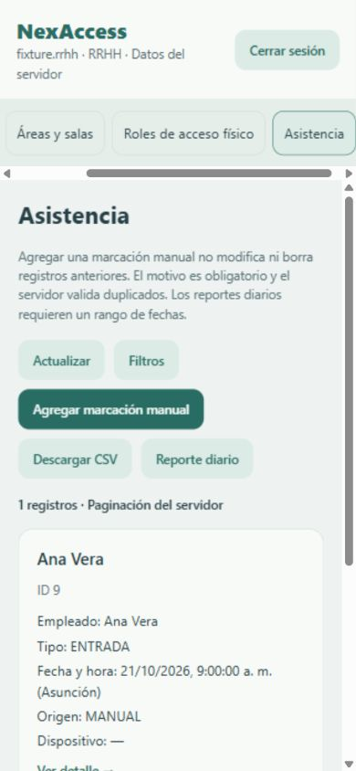

# Verificación de la integración API

Fecha: 21/10/2026. Backend revisado: `81511f3e3680b3ef6c45ac3b3a85a3431df2b3b5`. Frontend de partida: `a6f06b24261991c44e95ddd5d60c93f6eb9f2229`. Node 24.19.0 en Windows.

## Pruebas automatizadas locales

| Comprobación | Resultado |
|---|---|
| Cliente y contratos (`node --test integration/tests/api.test.cjs`) | 25 pruebas aprobadas |
| Maqueta web (`npm test` dentro de web) | 32 pruebas aprobadas |
| Móvil, UI conectada y maqueta (`npm test` dentro de mobile) | 20 pruebas aprobadas |
| TypeScript web y móvil (`npm run typecheck`) | Sin errores |
| ESLint web y móvil, incluidas nuevas pruebas de pantalla | Sin errores |
| Copias de código compartido (`node integration/sync.cjs --check`) | Idénticas |
| Huellas del backend (`node integration/check-contract.cjs RUTA_BACKEND`) | Coinciden 171 archivos fuente del backend revisado |
| Exportación web de la app web | Correcta, bundle de 1,3 MB |
| Exportación de la app móvil para web, Android e iOS | Correcta: web 5,3 MB, Android Hermes 7,4 MB, iOS Hermes 7 MB; 52 assets |

Los 25 casos de integración verifican IDs seguros, mapeo `codigo_credencial`, eliminación de campos ficticios, DTO de empleados/dispositivos, horarios nocturnos, permisos físicos frente a perfiles administrativos, fechas con zona, filtros/paginación, credenciales enmascaradas, `/auth/me`, rechazo de EMPLEADO como perfil del sistema, 401/409, CSV autenticado, JSON/HTML inválido, respuestas tardías después de logout, timeout sin reintento y bloqueo de reportes cuyo conteo supera 50.000 filas. Un caso usa HTTP real hacia un servidor sintético local; no ejecuta ASP.NET ni PostgreSQL.

Las cuatro nuevas pruebas de pantalla verifican el login sin selector de privilegios, menú RRHH restringido, asignación de rol físico por Seguridad mediante `/employees/12/roles/7` sin cuerpo y rotación confirmada de clave con visualización temporal.

## Verificación manual en navegador

Se inició Expo con `start --go --web --localhost --port 8091`, se probó a través del gateway local y se usó exclusivamente `integration/fixture.cjs` para escrituras.

1. Login sintético ADMIN: `/auth/login` seguido de `/auth/me` y lista de empleados del servidor.
2. Paginación: 21 empleados, segunda página con un registro, contador total conservado.
3. Búsqueda `Ana`: una coincidencia; la nueva consulta vuelve a la primera página.
4. Alta de empleado ficticio `TEST-UI-2026`: revisión, confirmación, POST con los campos del DTO y recarga. El ID proviene del fixture, no de la UI.
5. Historial filtrado con `RECHAZADO`, rango local 21/10/2026 y zona -03:00. La petición usa `from=2026-10-21T03:00:00.000Z` y `to=2026-10-22T02:59:59.000Z`.
6. Descarga `nexaccess-access-events.csv`: se leyó el archivo descargado y contiene la fila sintética esperada. La petición export usa los filtros aplicados, sin page/pageSize y sin token en la URL.
7. RRHH en viewport 390×844: solo Empleados, Áreas, Roles físicos y Asistencia; reporte diario con rango y marca incompleta del fixture. Escritorio revisado a 1280×900.
8. `/demo` sigue mostrando el login de la maqueta original. La sesión conectada no se guarda.

## Servicio publicado: solo comprobaciones anónimas

- `GET https://nexaccess.rattenkoenig.net/api/v1/health`: 200 y `{"status":"ok"}`.
- La misma ruta a través del gateway local apuntando al servicio HTTPS: 200. En navegador, **Comprobar conexión** mostró **Servicio disponible**.
- `OPTIONS /api/v1/auth/login` con Origin localhost, método POST y Content-Type: 405, sin cabecera CORS de autorización del origen.
- `GET /openapi/v1.json`: 404. El contrato se revisó en el código fuente fijado por commit.

No se intentaron credenciales ficticias ni se hicieron escrituras en el servicio publicado. El usuario confirmó que no existe entorno de pruebas. Un health estático no valida DB, cuentas, permisos ni operaciones de negocio.

## Pendiente de verificación

- Login, consultas y escrituras autenticadas contra la API ASP.NET desplegada, con cuenta y datos de prueba autorizados.
- PostgreSQL real, migraciones y pruebas de concurrencia/idempotencia/rollback de auditoría.
- Docker/Nginx y configuración del proxy/runner en el servidor. Docker y .NET no están disponibles en esta computadora; el código del backend no se modificó.
- Ejecución nativa en Expo Go/dispositivo o simulador. Se inició Expo en modo Go; no hay dispositivo ni SDK Android disponible. No se creó un dev client ni se usó EAS.
- Firmware ESP32, NFC y apertura de puertas; corresponden al servicio de dispositivos y al hardware.

Los informes de las maquetas anteriores son históricos y no sustituyen esta verificación. Las exportaciones de JavaScript y los fixtures no prueban ejecución nativa ni equivalencia completa con la API/DB de producción.
